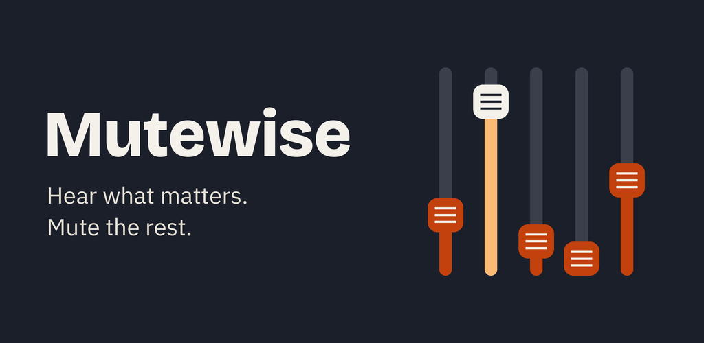
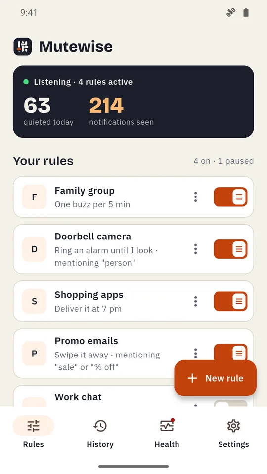
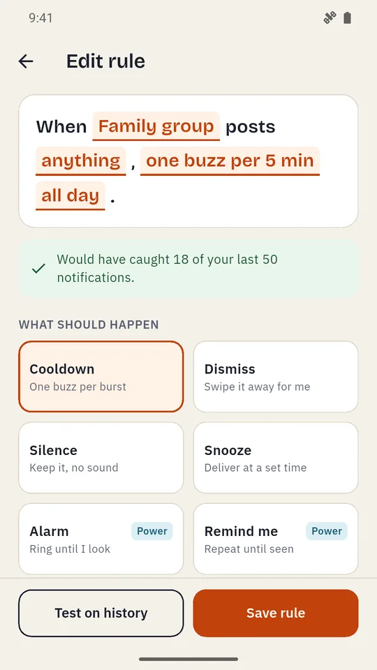
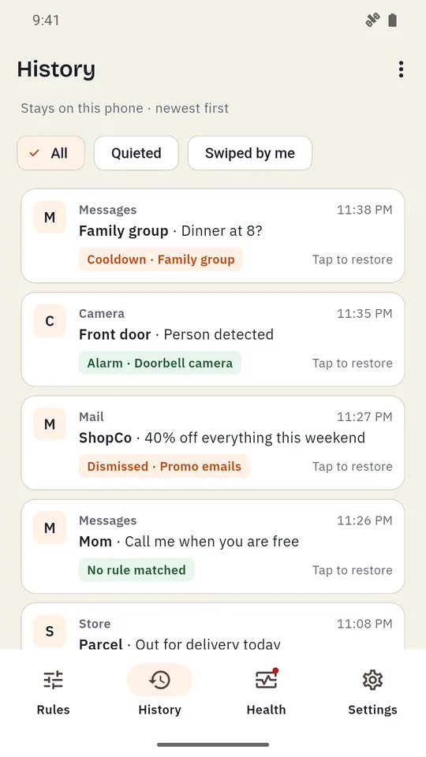

# Mutewise: Notification Manager

Mute group chats, batch promos and ring an alarm for the alerts that matter. A free notification manager for Android with rules you can test before you trust them.

  
  
  

## What it does

- **Rules in plain sentences.** "When Family group posts anything, one buzz per 5 min, all day." Tap any part to change it.
- **Test before you trust.** Every rule shows how many of your last 50 notifications it would have caught.
- **11 actions:** Cooldown, Dismiss, Silence, Snooze, Alarm (rings even on silent), Remind me, Hide content, Custom alert, Auto-reply, Press button and Undo.
- **Mute notifications by app, word and time,** including overnight schedules like 7 pm to 8 am.
- **Notification history with restore** for anything a rule swiped away.
- **Health checks** for notification access and battery settings, so your rules keep running.
- **Private:** notifications are read on your phone and never leave it. No account.
- **Free,** supported by ads. No banner ads.

## Links

- Website: https://mutewise.pages.dev/
- Privacy policy: https://mutewise.pages.dev/privacy/
- Teaser video: https://youtube.com/shorts/9ad06K-ur_o
- Support: anithabheesetty@gmail.com
- More apps from NK Tools: https://play.google.com/store/apps/developer?id=NK+Tools

© 2026 NK Tools. All rights reserved.
